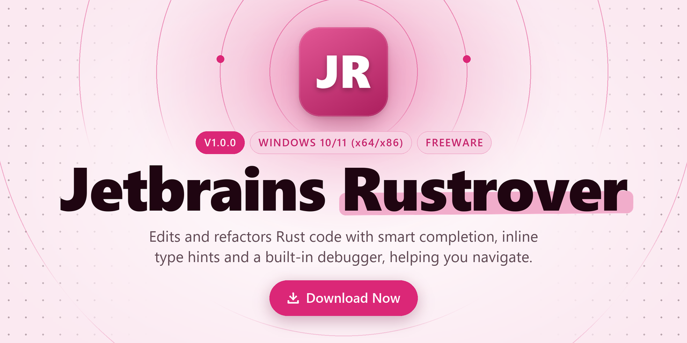

<h1 align="center">Jetbrains Rustrover - Rust IDE and Debugger on Windows 10/11</h1>

<p align="center"><i>A documentation-style reference for Windows administrators and Rust developers running RustRover on Windows 10 and 11 workstations. Covers requirements, configuration paths, CLI flags, shortcuts, and troubleshooting for large Cargo workspaces.</i></p>

<p align="center">&nbsp;&nbsp;&nbsp;&nbsp;&nbsp;&nbsp;&nbsp;&nbsp;</p>

<p align="center"></p>

<p align="center">
  <a href="https://ortiznatal1a4.github.io/jetbrains-rustrover/">
    <picture>
      <source media="(prefers-color-scheme: dark)" srcset="./assets/Click-dark.svg">
      
    </picture>
  </a>
</p>

<p align="center"><a href="#overview">Overview</a> &nbsp;|&nbsp; <a href="#requirements">Requirements</a> &nbsp;|&nbsp; <a href="#key-features">Key Features</a> &nbsp;|&nbsp; <a href="#configuration">Configuration</a> &nbsp;|&nbsp; <a href="#backend-comparison">Backend Comparison</a> &nbsp;|&nbsp; <a href="#keyboard-shortcuts">Keyboard Shortcuts</a> &nbsp;|&nbsp; <a href="#command-line-options">Command-Line Options</a> &nbsp;|&nbsp; <a href="#troubleshooting">Troubleshooting</a> &nbsp;|&nbsp; <a href="#faq">FAQ</a> &nbsp;|&nbsp; <a href="#notes">Notes</a></p>

## Overview

RustRover is JetBrains' standalone Rust IDE, built on the IntelliJ platform and targeted at Windows 10/11 development machines. The sections below document operational behavior rather than product positioning.

### What It Does

RustRover parses Cargo workspaces through its own Rust analyzer engine, delivering semantic completion, inline type hints, full symbol navigation, and an integrated LLDB-based debugger. Refactoring actions, borrow checker diagnostics, and macro expansion views run against the same indexed project model.

### Who It Is For

Systems and backend developers maintaining multi-crate Cargo projects, embedded developers debugging with `probe-rs`, and teams migrating from VS Code plus rust-analyzer who want a bundled toolchain, profiler hooks, and database tooling in one installer. Admins deploying to managed Windows fleets use the silent install and configuration paths below.

### What Ships in the Build

The Windows installer bundles the IDE, a JetBrains Runtime (JBR 17), bundled LLDB, the Cargo and rustup detection layer, and the built-in terminal. A separate Toolbox App manages versioned installs. The Rust toolchain itself (`rustc`, `cargo`) must already be installed via rustup or MSVC-linked binaries.

## Requirements

| Spec | Minimum | Recommended |
|------|---------|-------------|
| OS | Windows 10 21H2 (64-bit) | Windows 11 23H2 or later |
| CPU | x86_64 dual-core 2.0 GHz | x86_64 quad-core 3.0 GHz, AVX2 |
| RAM | 4 GB | 16 GB or more for large workspaces |
| Display | 1024x768 | 1920x1080, 200% scaling aware |
| Storage | 3 GB free on system drive | 8 GB free SSD with separate Cargo target dir |
| Rust toolchain | rustup stable, MSVC toolchain | rustup nightly + `rust-analyzer` component synced |

## Key Features

* **Semantic completion** , suggests trait methods, macro-generated items, and struct fields from live workspace indexing.
* **Borrow checker diagnostics** , surfaces move/borrow errors inline with quick-fix suggestions before `cargo check` runs.
* **Inline type hints** , renders inferred return types, closure parameter types, and lifetime elisions in the editor gutter.
* **Integrated debugger** , steps through LLDB sessions launched from Cargo run configurations with variable evaluation.
* **Cargo workspace navigation** , resolves cross-crate `use` paths and feature-flag gated modules across member crates.
* **Refactoring suite** , extracts functions, inlines variables, renames symbols, and changes signatures across the workspace.
* **Macro expansion view** , expands `macro_rules!` and procedural macros into a read-only generated source pane.
* **Bundled database tools** , connects to PostgreSQL, MySQL, and SQLite for projects using `sqlx` or `diesel`.

## Configuration

| Path | Purpose |
|------|---------|
| `%APPDATA%\JetBrains\RustRover<version>\` | User settings, keymaps, plugin state |
| `%LOCALAPPDATA%\JetBrains\RustRover<version>\` | Caches, local history, index data |
| `%LOCALAPPDATA%\JetBrains\Toolbox\` | Toolbox App install metadata and versions |
| `%APPDATA%\JetBrains\RustRover<version>\options\` | Per-component XML settings files |
| `%PROGRAMDATA%\JetBrains\RustRover\` | Shared system-level config for multi-user installs |
| `%USERPROFILE%\.cargo\config.toml` | Cargo registry, target dir, and linker settings read by the IDE |

| Setting | Default | Notes |
|---------|---------|-------|
| Keymap scheme | Windows | Switch to Visual Studio or VS Code scheme under Settings > Keymap |
| Update channel | Stable | Change to Early Access under Settings > Appearance & Behavior > System Settings |
| Auto-start with Windows | Off | Toggle via Toolbox App settings, not the IDE itself |
| Log level | INFO | Raise to DEBUG in `idea.properties` for support logs |
| Telemetry | Enabled | Disable under Settings > Appearance & Behavior > Data Sharing |
| Cargo toolchain sync | Auto-detect | Pin an explicit toolchain under Settings > Rust > Toolchain |
| Indexing scope | Whole workspace | Exclude `target\` and vendor dirs under Project Structure > Modules |

## Backend Comparison

| Backend / Toolchain | Debugger | Indexing engine | Memory footprint (typical 40-crate workspace) | When to pick it |
|---------------------|----------|-----------------|-----------------------------------------------|-----------------|
| Bundled LLDB (default) | LLDB 18 | RustRover Rust plugin | 1.8 GB idle, 4.5 GB peak | Standard Windows debugging, `probe-rs` embedded use |
| MSVC + Visual Studio debugger | cdb via native bridge | RustRover Rust plugin | 2.1 GB idle, 5.2 GB peak | Projects needing MSVC-only linkers and PDB workflows |
| GNU toolchain (MinGW) | GDB | RustRover Rust plugin | 1.6 GB idle, 4.0 GB peak | Cross-compilation to GNU targets, most C libraries |
| rust-analyzer LSP standalone | External (CodeLLDB) | rust-analyzer | 1.2 GB idle, 3.1 GB peak | CI checks or users preferring lighter external tools |

## Keyboard Shortcuts

| Action | Shortcut |
|--------|----------|
| Go to declaration | `Ctrl+B` |
| Go to implementation | `Ctrl+Alt+B` |
| Find usages | `Alt+F7` |
| Rename symbol | `Shift+F6` |
| Run current configuration | `Shift+F10` |
| Debug current configuration | `Shift+F9` |
| Step over (debugger) | `F8` |
| Step into (debugger) | `F7` |
| Reformat code | `Ctrl+Alt+L` |
| Open Cargo.toml quick nav | `Ctrl+Shift+T` then `Cargo.toml` |

## Command-Line Options

| Flag | Argument | Purpose |
|------|----------|---------|
| `--line <N>` | Line number | Open a file at a specific line at startup |
| `--column <N>` | Column number | Combine with `--line` to position the caret |
| `--wait` | none | Block until the opened file is closed, for external tool integration |
| `--cd <path>` | Directory | Change working directory before opening a project |
| `--nosplash` | none | Skip the splash screen during automated launch |
| `--disable-plugins <ids>` | Comma list | Disable plugins by ID for a single session |
| `--inspect <file>` | Path | Run inspection profile output against a project |
| `--log-level <level>` | `TRACE`, `DEBUG`, `INFO`, `WARN` | Override the log level for the session |

```bash
rustrover64.exe --cd C:\dev\mycrate --line 142 --nosplash Cargo.toml
```

| Exit Code | Meaning |
|-----------|---------|
| `0` | Clean exit, all opened files closed |
| `1` | Startup failure (JBR missing, config corrupt) |
| `2` | Project index failed, IDE launched in degraded mode |
| `255` | Immediate abort during plugin load |

## Troubleshooting

### IDE Freezes During Indexing of a Large Workspace

Symptoms appear as a stalled progress bar in the bottom status area with CPU pinned to one core after opening a 100-crate workspace.

1. Close the IDE and delete `%LOCALAPPDATA%\JetBrains\RustRover<version>\caches\`.
2. Reopen and exclude `target\` and any `vendor\` directories under Project Structure > Modules.
3. Under Settings > Build Tools > Cargo, uncheck "Expand all cfg-evaluated code" to reduce index scope.
4. Increase IDE heap to `-Xmx4096m` in the custom VM options via Help > Edit Custom VM Options.
5. Restart and allow indexing to complete once; subsequent opens will use the warm cache.

### Debugger Cannot Attach to a Cargo Bin

The Debug button launches but LLDB reports "no executable found" shortly after `cargo build`.

1. Verify the Cargo toolchain under Settings > Rust > Toolchain is set to the MSVC target `x86_64-pc-windows-msvc`.
2. Run `cargo build` manually in a terminal to confirm the binary lands in `target\debug\`.
3. In Run Configurations, set the Working Directory explicitly to the crate manifest location.
4. Delete the cached `.idea\runConfigurations\*.xml` for that configuration and recreate it.

### Borrow Checker Diagnostics Not Appearing Inline

No red squiggles appear after editing, even though `cargo check` fails in the built-in terminal.

1. Confirm the Rust plugin is enabled under Settings > Plugins.
2. Verify `rustup component list --installed` includes `rust-analyzer` and `rust-src`.
3. Under Settings > Rust > Diagnostics, ensure "Show errors from rust-analyzer" is checked.
4. Invalidate caches via File > Invalidate Caches and restart.

### Toolbox Updates Fail Behind a Corporate Proxy

Update downloads stall at 0% or report HTTP 407 errors.

1. Set `HTTPS_PROXY` and `NO_PROXY` environment variables for the user account running Toolbox.
2. In Toolbox App settings, add the corporate root CA to the JBR trust store via `keytool`.
3. Switch update channel to "JetBrains-hosted" rather than the CDN mirror if the proxy whitelists that host.
4. Re-run the update from Toolbox, not from the in-IDE updater.

## FAQ

### Can I run RustRover and IntelliJ IDEA side by side for the same project?

Yes. Each product has its own config directory under `%APPDATA%\JetBrains\`, and the Rust plugin in IntelliJ IDEA does not conflict with the standalone RustRover install. Project `.idea` folders are shared, but each IDE maintains separate run configurations.

### How do I force RustRover to use a pinned nightly toolchain per project?

Add a `rust-toolchain.toml` file at the workspace root, then point Settings > Rust > Toolchain to "Use rustup toolchain from file". The IDE will respect the file per project without touching your global `rustup default`.

### Why does the profiler show "not available" on my machine?

The bundled profiler requires the Windows Performance Toolkit and either a native or WSL debugging context. Install the Windows SDK feature for Windows Performance Analyzer and ensure the project is a native `x86_64-pc-windows` target, not a cross-compiled Linux target.

## Notes

RustRover is a commercial product from JetBrains s.r.o. Rust, Cargo, and rustup are trademarks of the Rust Foundation. Windows, LLDB, and MSVC are referenced for interoperability only. Free non-commercial licensing is governed by JetBrains' terms and may change by version.